# Maktaba · مكتبة — Algerian & world literature

> **TD-TP 2 — Create a React Application with Redux for State Management**
> Module WAMD · ENSTA · SS/IA, first semester 2026

| | |
|---|---|
| **Student** | AMEDJKOUH Darine |
| **Store name** | Maktaba (مكتبة — “bookshop” in Arabic) |
| **Category** | Books — Algerian and world literature |

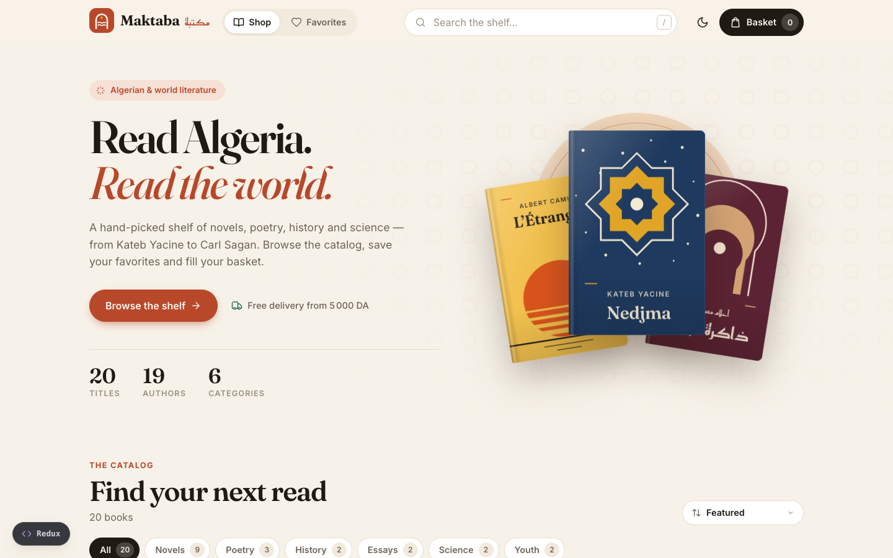

---

## 1. Application description

**Maktaba** is a small e-commerce front-end for an online bookshop. Users browse a catalog of
20 books (Kateb Yacine, Assia Djebar, Mohammed Dib, Ahlam Mosteghanemi, Camus, Fanon, Sagan…),
search and filter it, open a book’s details, save favorites and manage a shopping basket
whose totals update instantly.

The visual identity is inspired by Algerian heritage: zellige stars, Moorish arches and Kabyle
motifs. **Every book cover is drawn in code** (SVG + CSS) by the reusable `<BookCover />`
component, so the project uses no image files and works offline.

Following the lab scope, there is **no backend, database, authentication or payment**. The
catalog is static data loaded into the Redux store, and checkout is a demo confirmation.

## 2. Technologies used

| Technology | Purpose |
|---|---|
| **React 19** (JSX, function components, hooks) | User interface |
| **Redux** via **Redux Toolkit** `configureStore` | Global state store (Redux DevTools enabled) |
| **React-Redux 9** (`Provider`, `useSelector`, `useDispatch`) | Connects components to the store |
| **Vite** | Dev server and production build |
| **JavaScript ES6+** | Application logic |
| **CSS** (custom properties, grid, container queries) | Styling, light/dark themes, responsive layout |
| **@fontsource** (Fraunces, Inter, Reem Kufi) | Self-hosted fonts, no internet needed |
| **ESLint** | Code quality |

## 3. How to run the application

Requirements: **Node.js 20.19+ or 22.12+** and npm.

```bash
# 1. Install dependencies
npm install

# 2. Start the development server
npm run dev
# → open http://localhost:5173

# Optional
npm run build     # production build in dist/
npm run preview   # serve the production build
npm run lint      # check the code with ESLint
```

## 4. Project structure

```
src/
├── main.jsx                 # Entry point: <Provider store={store}> wraps <App />
├── App.jsx                  # Layout, simple navigation, details dialog
├── data/
│   └── products.js          # Static catalog (20 books) + shop constants
├── redux/
│   ├── store.js             # configureStore + localStorage persistence
│   ├── actionTypes.js       # All action type constants
│   ├── actions/             # Action creators
│   │   ├── cartActions.js
│   │   ├── favoritesActions.js
│   │   ├── filterActions.js
│   │   └── uiActions.js
│   ├── reducers/            # One reducer per part of the state
│   │   ├── index.js         # combineReducers → rootReducer
│   │   ├── productsReducer.js
│   │   ├── cartReducer.js
│   │   ├── favoritesReducer.js
│   │   ├── filtersReducer.js
│   │   └── uiReducer.js
│   ├── selectors.js         # Read & derive state (memoized with createSelector)
│   ├── localStorage.js      # Load / save persisted state
│   └── middleware/
│       └── actionLogger.js  # Records dispatched actions for the in-app inspector
├── pages/
│   ├── ShopPage.jsx         # Hero + filterable catalog
│   └── FavoritesPage.jsx    # Saved books
├── components/              # One folder per component (JSX + CSS)
│   ├── Header/  Hero/  Footer/  Logo/  Icon/
│   ├── ProductGrid/  ProductCard/  BookCover/  ProductDetails/
│   ├── CategoryFilter/  SortSelect/
│   ├── CartDrawer/  CartItem/  QuantityStepper/  Price/  RatingStars/
│   └── EmptyState/  Toast/  StateInspector/
├── styles/global.css        # Design tokens, light/dark themes, base styles
└── utils/format.js          # Price formatting (1 200 DA), discount %
```

## 5. Main React components

| Component | Role | Props | State used |
|---|---|---|---|
| `App` | Root layout, page switching, details dialog | — | **Local**: `page`, `selectedProductId` · **Redux**: theme, cart open |
| `Header` | Logo, navigation, search, theme toggle, basket button | `currentPage`, `onNavigate` | **Redux**: search query, theme, cart and favorites counts · **Local**: `isScrolled` |
| `Hero` | Landing section with featured books and stats | `onBrowse`, `onOpenDetails` | **Redux**: products, categories |
| `CategoryFilter` | Category chips with counts | — | **Redux**: `filters.category` |
| `SortSelect` | Sorting drop-down | — | **Redux**: `filters.sort` |
| `ProductGrid` | Reusable grid (shop + favorites) | `products`, `onOpenDetails` | — |
| `ProductCard` | One book: cover, info, price, add / quantity, favorite | `product`, `onOpenDetails`, `index` | **Redux**: quantity in cart, favorite status |
| `BookCover` | Reusable generated cover (card, dialog, cart, hero) | `book` | — |
| `ProductDetails` | Dialog with description, specs, quantity picker | `productId`, `onClose` | **Local**: chosen `quantity`, `justAdded` · **Redux**: product, cart, favorites |
| `CartDrawer` | Slide-in basket with totals and checkout | — | **Redux**: cart items, totals, open state · **Local**: `confirmedOrder` |
| `CartItem` | One basket line | `item` | dispatches cart actions |
| `QuantityStepper` | Reusable − / + control | `quantity`, `onIncrease`, `onDecrease`, `min`, `max`… | — (fully controlled by props) |
| `Price`, `RatingStars`, `EmptyState`, `Icon`, `Logo` | Small presentational components | various | — |
| `Toast` | Short feedback notification | — | **Redux**: `ui.toast` |
| `StateInspector` | Developer panel: live Redux state + last actions | — | **Local**: open / tab · **Redux**: whole state |

**Local state or Redux?** Data needed by several unrelated components (cart, favorites, filters,
theme, basket open/closed, notifications) lives in **Redux**. Data used by one component only
(the quantity picked in the dialog, the header shadow, the order confirmation) stays in
**React local state** (`useState`).

## 6. Redux state managed by the application

```js
{
  products:  { items: [ /* 20 books */ ] },            // static catalog (read-only)
  cart:      { items: [ { id: 'nedjma', quantity: 2 } ] },
  favorites: { ids: [ 'l-etranger', 'memory-in-the-flesh' ] },
  filters:   { query: '', category: 'All', sort: 'featured' },
  ui:        { theme: 'light', isCartOpen: false, toast: null }
}
```

The cart only stores `{ id, quantity }`. Titles, prices and totals are **derived** by selectors
(`selectCartItems`, `selectCartTotals`), so no data is duplicated.

### Actions

| Reducer | Action type | Action creator | Effect |
|---|---|---|---|
| cart | `cart/addToCart` | `addToCart(id, quantity)` | Adds a book or increases its quantity (max 10) |
| cart | `cart/removeFromCart` | `removeFromCart(id)` | Removes a book |
| cart | `cart/increaseQuantity` | `increaseQuantity(id)` | +1 |
| cart | `cart/decreaseQuantity` | `decreaseQuantity(id)` | −1 (removes the book at 0) |
| cart | `cart/clearCart` | `clearCart()` | Empties the basket |
| favorites | `favorites/toggleFavorite` | `toggleFavorite(id)` | Adds / removes a favorite |
| filters | `filters/setSearchQuery` | `setSearchQuery(query)` | Search text |
| filters | `filters/setCategory` | `setCategory(category)` | Category filter |
| filters | `filters/setSort` | `setSort(sort)` | Sorting order |
| filters | `filters/resetFilters` | `resetFilters()` | Back to defaults |
| ui | `ui/toggleTheme` | `toggleTheme()` | Light ↔ dark |
| ui | `ui/openCart` / `ui/closeCart` | `openCart()` / `closeCart()` | Basket drawer |
| ui | `ui/showToast` / `ui/hideToast` | `showToast(message)` / `hideToast()` | Notifications |

### Data flow example — “Add to basket”

```
click “Add” in <ProductCard>
  → dispatch(addToCart('nedjma'))              // action { type: 'cart/addToCart', payload: { id, quantity: 1 } }
  → cartReducer returns a NEW state             // pure function, no mutation
  → store notifies subscribed components
  → <Header> badge, <ProductCard> stepper and <CartDrawer> totals re-render
  → store.subscribe saves the cart to localStorage
```

## 7. Implemented features

**Required**
- [x] React application with JSX and many reusable components
- [x] Props (e.g. `product`, `onOpenDetails`, `quantity`/`onIncrease`)
- [x] Local state where appropriate (`useState`)
- [x] User events (click, change, keyboard: Escape closes dialogs, `/` focuses search)
- [x] Product catalog with product information
- [x] Shopping cart: add, remove, and dynamic updates
- [x] Redux store, action types, action creators, reducers (`combineReducers`)
- [x] React-Redux: `Provider`, `useSelector` (read), `useDispatch` (dispatch)
- [x] Updated global state displayed everywhere (badges, steppers, totals, inspector panel)
- [x] Clear, responsive, user-friendly interface (desktop, tablet, mobile)

**Optional (from the lab’s list)**
- [x] Product search (title, author, accents ignored: “etranger” finds “L’Étranger”)
- [x] Category filtering with counts
- [x] Product sorting (price, rating, date, title)
- [x] Product details dialog
- [x] Quantity management (card, dialog and basket)
- [x] Cart total with subtotal, discounts, delivery fee and a free-delivery progress bar
- [x] Discount display (−20 % badges, struck-through old prices)
- [x] Favorites page
- [x] Dark / light mode (follows the system preference on first visit)
- [x] Simple navigation (Shop / Favorites)
- [x] Local storage (cart, favorites and theme survive a page reload)

**Testing and debugging**
- In-app **Redux inspector** (bottom-left “Redux” button): live store state and the last
  dispatched actions with their payloads.
- Compatible with the **Redux DevTools** browser extension (enabled by `configureStore`).
- Redux Toolkit’s development checks warn if a reducer mutates the state.

## 8. Screenshots

| | |
|---|---|
| 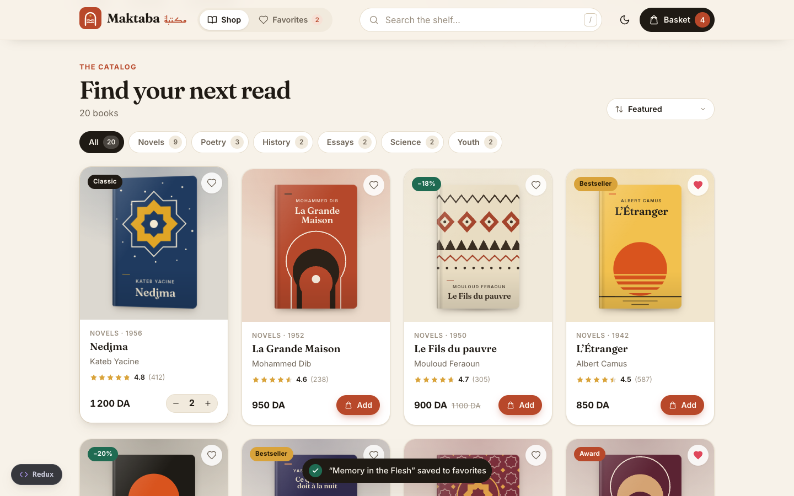 Catalog with items in the basket | 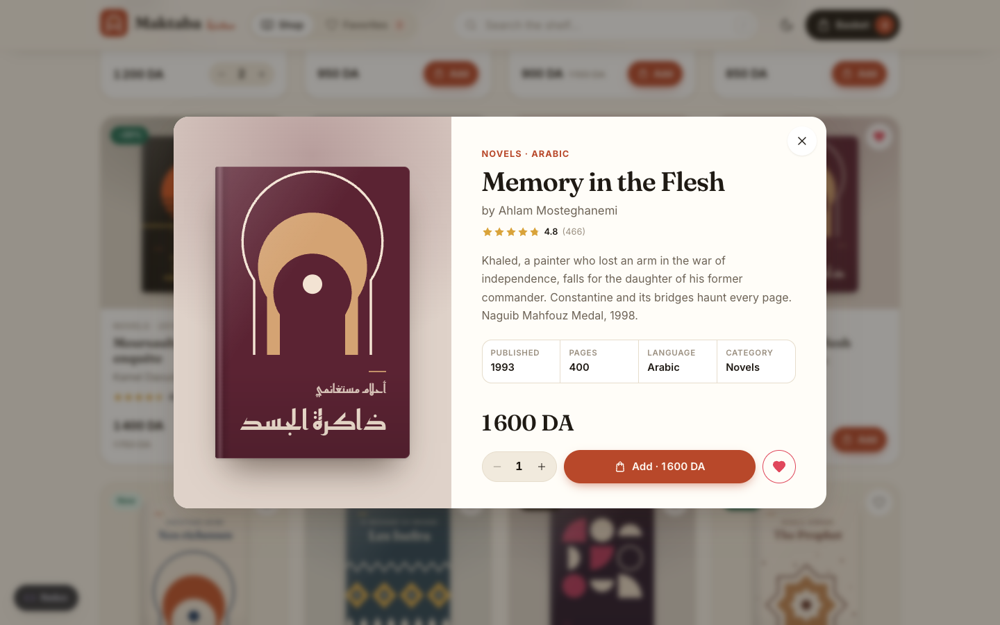 Product details |
| 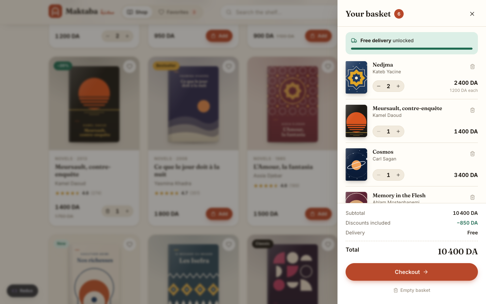 Shopping basket | 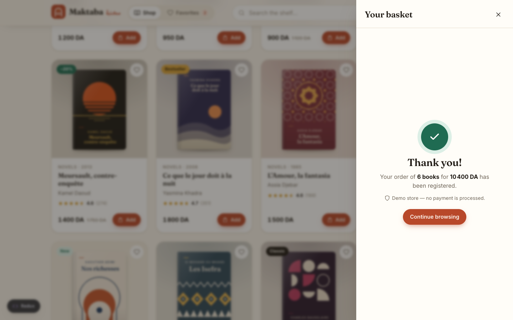 Order confirmation (demo) |
| 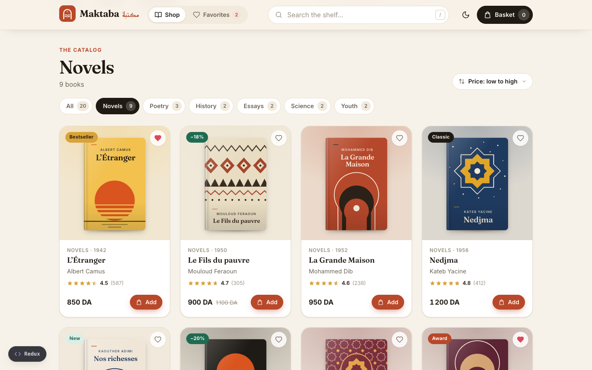 Category filter + sorting | 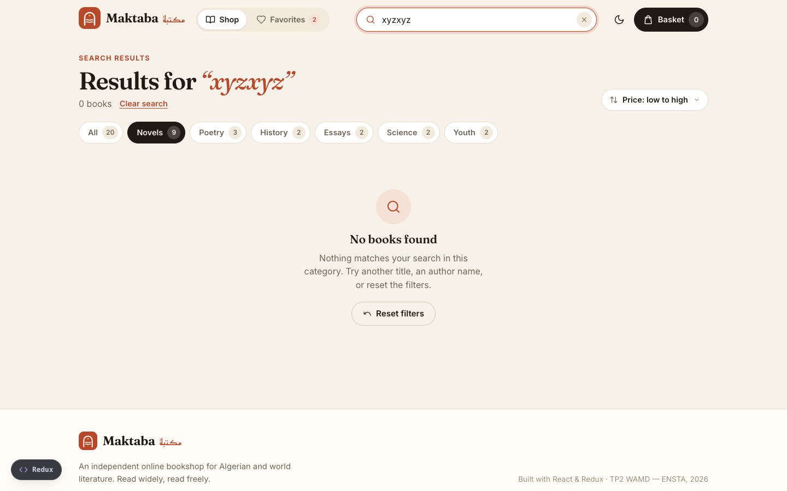 Empty search state |
| 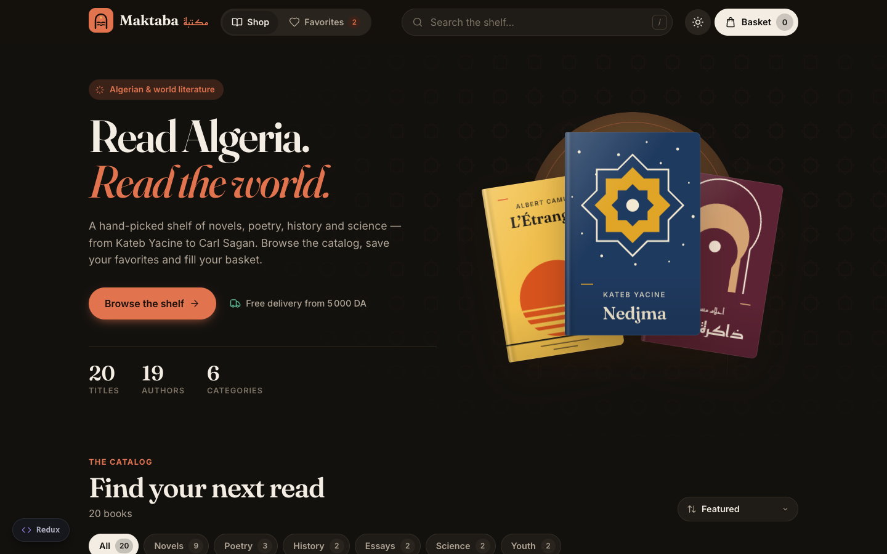 Dark mode | 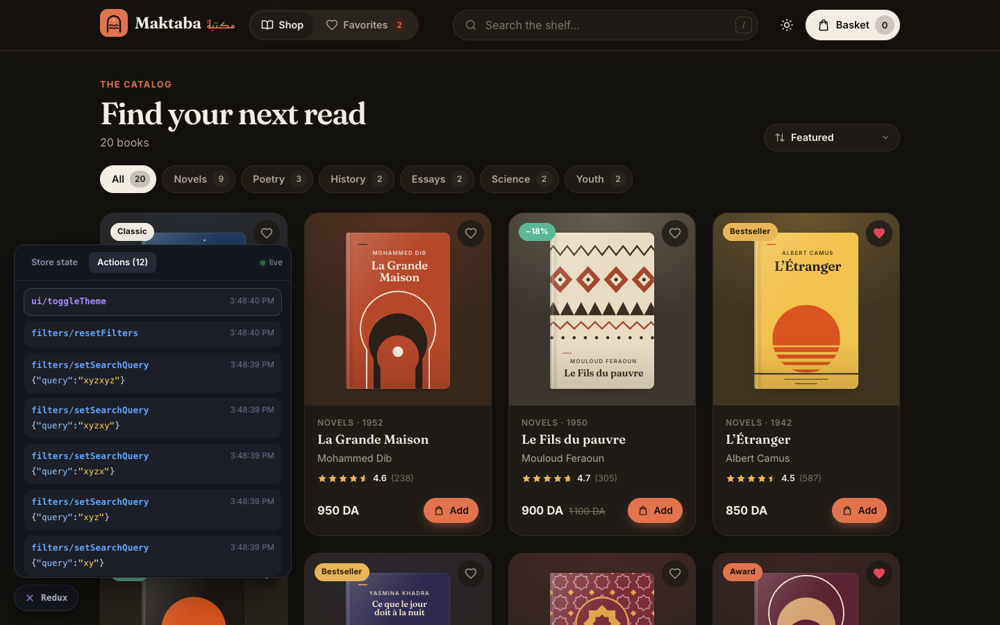 Redux inspector |
| 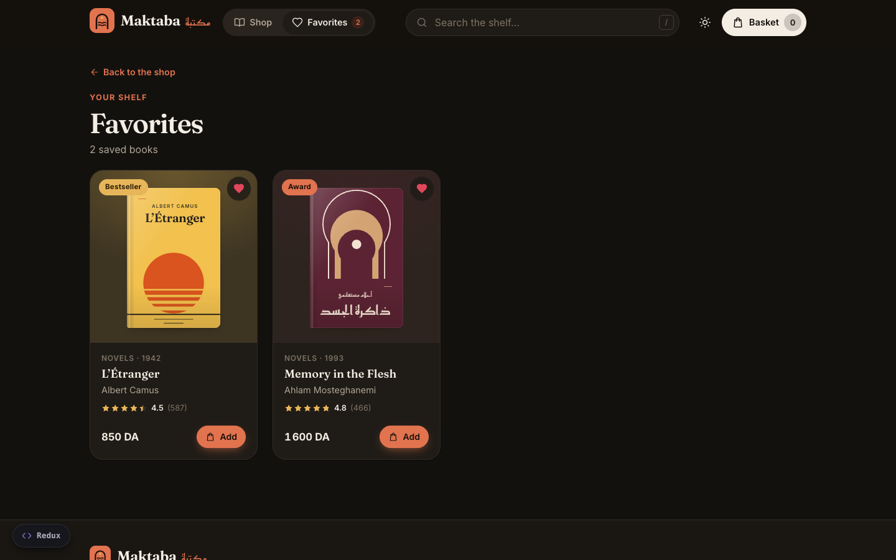 Favorites page | 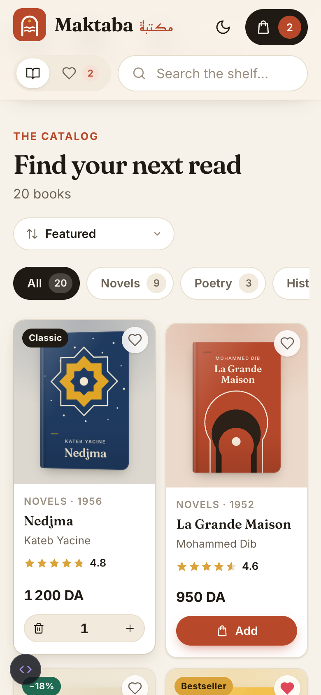 Mobile |

More screenshots are in the [`screenshots/`](screenshots) folder.

---

_Book descriptions are short summaries written for this lab. Prices, ratings and review counts are fictional._
