# Maktaba API — مكتبة

> **TD-TP 3 — E-Commerce Backend: REST API with Node.js, Express.js, MongoDB, JWT, OAuth 2.0 and rate limiting**
> Module WAMD · ENSTA · SS/IA, first semester 2026

| | |
|---|---|
| **Student** | AMEDJKOUH Darine |
| **Frontend** | Maktaba bookshop from TD-TP 2 (root of this repository) |
| **Backend** | this `server/` folder |

---

## 1. Application description

This is the backend of **Maktaba**, the online bookshop built with React and Redux in TD-TP 2.
In TD-TP 2 the 20 books were a JavaScript array inside the frontend. They now live in a
**MongoDB** database and are served by a **REST API** built with **Node.js** and **Express.js**.

The API provides:

- **Products**: read the catalog (public) and create, update or delete books (authentication required).
- **Users**: registration with a hashed password, and login that returns a **JWT**.
- **OAuth 2.0**: a small built-in authorization server (Client Credentials grant). Its access
  tokens also unlock the protected endpoints.
- **Rate limiting**: 100 requests per 15 minutes on the whole API and 5 per 15 minutes on login.
- **Consistent JSON errors** with the correct HTTP status codes, and **CORS** for the React dev server.

On the first start, the database is filled with the 20 books of the TD-TP 2 catalog
(`src/data/products.js`), so the API can be tested straight away.

```
React + Redux frontend  ──HTTP / JSON──▶  Node.js + Express REST API  ──Mongoose──▶  MongoDB
  (TD-TP 2)                                 products · auth · OAuth · JWT middleware   products · users
```

## 2. Technologies used

| Technology | Purpose |
|---|---|
| **Node.js** (ES modules) | Backend runtime |
| **Express.js 5** | Web framework, routing, middleware |
| **MongoDB** | NoSQL database |
| **Mongoose** | Schemas, models and validation |
| **mongodb-memory-server** | Starts a real MongoDB automatically when no `MONGODB_URI` is set |
| **bcryptjs** | Password hashing |
| **jsonwebtoken** | Creating and verifying JWTs and OAuth access tokens |
| **express-rate-limit** | Rate limiting |
| **cors** | Allows requests from the React app (`http://localhost:5173`) |
| **dotenv** | Loads environment variables from `.env` |
| **Postman / Thunder Client** | API testing |

## 3. Installation and running

Requirements: **Node.js 20+** and npm. Nothing else needs to be installed.

```bash
cd server
npm install
cp .env.example .env     # then edit the secrets in .env (see section 4)
npm run dev              # restarts automatically when a file changes
# or: npm start
```

Expected output:

```
No MONGODB_URI set: using an in-memory MongoDB (data resets on restart)
MongoDB connected (database: maktaba)
Seeded 20 products
API running on http://localhost:3000
```

On the very first start, `mongodb-memory-server` downloads the MongoDB binary (about 100 MB).
This happens only once.

## 4. Configuring MongoDB and environment variables

All configuration is read from `server/.env`. This file is **excluded by `.gitignore`**. Only
`.env.example`, which contains placeholders, is committed.

| Variable | Meaning | Example |
|---|---|---|
| `PORT` | API port | `3000` |
| `MONGODB_URI` | MongoDB connection string. **Leave empty** to use the automatic in-memory MongoDB | `mongodb://127.0.0.1:27017/maktaba` |
| `JWT_SECRET` | Secret used to sign tokens. Use a long random string | `openssl rand -hex 32` |
| `CLIENT_ORIGIN` | Frontend origin allowed by CORS | `http://localhost:5173` |
| `OAUTH_CLIENT_ID` | OAuth 2.0 client ID (for Postman) | `maktaba-postman` |
| `OAUTH_CLIENT_SECRET` | OAuth 2.0 client secret | `openssl rand -hex 16` |

**MongoDB options**

1. **No setup (default):** leave `MONGODB_URI` empty. A real MongoDB server runs in memory
   while the API is running. The data is reset and the 20 books are seeded again on every restart.
2. **Local MongoDB:** install MongoDB Community Server (`brew install mongodb-community` on macOS),
   start it, then set `MONGODB_URI=mongodb://127.0.0.1:27017/maktaba`.
3. **MongoDB Atlas:** create a free cluster and a database user, allow your IP address under
   *Network Access*, then paste the connection string into `MONGODB_URI`
   (`mongodb+srv://<user>:<password>@<cluster>/maktaba`).

With options 2 and 3 the data is kept between restarts. The books are only seeded when the
`products` collection is empty.

## 5. Project structure

```
server/
├── .env.example              # Environment variable placeholders (.env itself is git-ignored)
├── package.json
├── postman/
│   └── maktaba-api.postman_collection.json   # All the test requests (Postman / Thunder Client)
└── src/
    ├── server.js             # Entry point: loads .env, connects to MongoDB, seeds, starts Express
    ├── app.js                # Express app: CORS, JSON parsing, rate limit, routes, error handling
    ├── seed.js               # Inserts the 20 TD-TP 2 books if the collection is empty
    ├── config/
    │   └── db.js             # Mongoose connection (MONGODB_URI or in-memory MongoDB)
    ├── models/
    │   ├── Product.js        # Product schema
    │   └── User.js           # User schema (passwordHash is never returned)
    ├── routes/
    │   ├── auth.js           # POST /register, POST /login
    │   ├── oauth.js          # POST /token (OAuth 2.0 Client Credentials)
    │   └── products.js       # Product CRUD
    └── middleware/
        ├── auth.js           # requireAuth: checks "Authorization: Bearer <token>"
        ├── rateLimit.js      # General and login rate limiters
        └── errorHandler.js   # 404 for unknown routes + consistent JSON errors
```

## 6. Database models

### Product

| Field | Type | Rules |
|---|---|---|
| `name` | String | required |
| `author` | String | optional (these are books) |
| `description` | String | required |
| `price` | Number | required, ≥ 0 (Algerian dinars) |
| `category` | String | required (Novels, Poetry, History, Essays, Science, Youth) |
| `imageUrl` | String | optional (the React app draws its covers in code) |
| `stock` | Number | default 0, ≥ 0 |
| `createdAt`, `updatedAt` | Date | added automatically |

### User

| Field | Type | Rules |
|---|---|---|
| `name` | String | required |
| `email` | String | required, **unique**, lowercase, valid format |
| `passwordHash` | String | bcrypt hash (10 salt rounds). The plain password is never stored |
| `createdAt`, `updatedAt` | Date | added automatically |

In JSON responses, MongoDB's `_id` is returned as `id`, and `passwordHash` is never included.

Example product:

```json
{
  "id": "6ae76694aa9e279a7e0e1f30",
  "name": "Nedjma",
  "author": "Kateb Yacine",
  "description": "Four young men, one elusive woman, and a country searching for itself…",
  "price": 1200,
  "category": "Novels",
  "imageUrl": "",
  "stock": 20,
  "createdAt": "2026-11-01T16:19:32.109Z",
  "updatedAt": "2026-11-01T16:19:32.109Z"
}
```

## 7. API endpoints and access requirements

Base URL: `http://localhost:3000/api`

### Authentication

| Method | Endpoint | Body | Success | Errors |
|---|---|---|---|---|
| POST | `/auth/register` | `{ name, email, password }` | **201** `{ message, user }` | 400 missing or invalid field · 409 email already registered |
| POST | `/auth/login` | `{ email, password }` | **200** `{ token, user }` | 400 missing field · 401 wrong credentials · 429 too many attempts |
| POST | `/oauth/token` | form: `grant_type=client_credentials` + client credentials | **200** `{ access_token, token_type, expires_in }` | 400 unsupported grant · 401 invalid client |

### Products

| Method | Endpoint | Access | Success | Errors |
|---|---|---|---|---|
| GET | `/products` | Public | **200** array of products | |
| GET | `/products/:id` | Public | **200** product | 404 unknown or invalid id |
| POST | `/products` | **Token required** | **201** created product | 400 invalid data · 401 no or invalid token |
| PUT | `/products/:id` | **Token required** | **200** updated product | 400 · 401 · 404 |
| DELETE | `/products/:id` | **Token required** | **200** `{ message, product }` | 401 · 404 |

"Token required" means `Authorization: Bearer <token>`, where the token is either a user JWT
from `/auth/login` or an OAuth 2.0 access token from `/oauth/token`. As the lab allows, there
are no roles: any authenticated user can manage products.

### Error format

Every error uses the same JSON shape:

```json
{ "error": "price must be a number" }
```

| Status | When |
|---|---|
| 400 Bad Request | Missing or invalid field, wrong type, malformed JSON |
| 401 Unauthorized | Missing, invalid or expired token, or wrong login credentials |
| 404 Not Found | Unknown product, invalid product id, or unknown route |
| 409 Conflict | Email already registered |
| 429 Too Many Requests | Rate limit exceeded |
| 500 Internal Server Error | Unexpected error (logged on the server) |

## 8. JWT authentication mechanism

```
1. Client  ── POST /api/auth/login { email, password } ──▶  API
2. API     finds the user by email and checks the password with bcrypt.compare()
3. API     signs a JWT with JWT_SECRET:  payload { sub: userId, email }, expires in 1 hour
4. API     ◀── 200 { token, user }
5. Client  sends the token with every protected request:  Authorization: Bearer <token>
6. requireAuth middleware (src/middleware/auth.js):
     reads the header → jwt.verify(token, JWT_SECRET)
       ├─ valid   → req.auth = payload, next()  → the route runs
       └─ missing / invalid / expired → 401 { "error": ... }
```

- **Passwords** are hashed with `bcrypt.hash(password, 10)` at registration. Only the hash is
  stored in MongoDB.
- **Login errors** use the same message for an unknown email and a wrong password, so an attacker
  cannot discover which emails are registered.
- **The secret** is read from the `JWT_SECRET` environment variable. It is never hardcoded, and
  the server refuses to start without it.
- **The token is stateless.** The server does not store it. The signature proves it was issued by
  this API and has not been modified, and the `exp` claim limits its lifetime to 1 hour.

## 9. OAuth 2.0

Instead of depending on an external provider such as Google or GitHub, which would need an
account, a registered app and a consent screen, the API includes a **minimal OAuth 2.0
authorization server**. It implements the **Client Credentials grant** (RFC 6749 §4.4), which
lets an application such as Postman authenticate itself and receive an access token:

```
1. Postman ── POST /api/oauth/token
              Authorization: Basic base64(client_id:client_secret)
              grant_type=client_credentials ──────────────────────▶  API
2. API     checks the client against OAUTH_CLIENT_ID / OAUTH_CLIENT_SECRET
3. API     ◀── 200 { access_token, token_type: "Bearer", expires_in: 3600, scope: "products:write" }
4. Postman ── POST /api/products   Authorization: Bearer <access_token> ──▶  requireAuth → 201
   Invalid or missing token → 401
```

The access token is signed with the same secret as the login JWT, so the same `requireAuth`
middleware accepts both.

**Testing it in Postman or Thunder Client**

1. Open the request *4. OAuth 2.0 → Create a product (OAuth 2.0 token)*.
2. Open the **Authorization** tab, choose type **OAuth 2.0**, and fill in:
   - Grant type: **Client Credentials**
   - Access Token URL: `http://localhost:3000/api/oauth/token`
   - Client ID / Client Secret: the values of `OAUTH_CLIENT_ID` / `OAUTH_CLIENT_SECRET` in `.env`
   - Client Authentication: *Send as Basic Auth header*
3. Click **Get New Access Token**, then **Use Token**, then **Send**. The response is `201 Created`.
4. Remove or alter the token and send again. The response is `401 Unauthorized`.

## 10. Rate limiting

Configured in `src/middleware/rateLimit.js` with `express-rate-limit`, per client IP:

| Scope | Limit | Response when exceeded |
|---|---|---|
| All `/api/*` routes | 100 requests / 15 minutes | 429 `{ "error": "Too many requests, please try again in 15 minutes" }` |
| `POST /api/auth/login` | 5 requests / 15 minutes | 429 `{ "error": "Too many login attempts, please try again in 15 minutes" }` |

Responses include the standard `RateLimit` and `RateLimit-Policy` headers, which show the
remaining quota. Limits are kept in memory, so restarting the server resets them.

## 11. API testing

Import `postman/maktaba-api.postman_collection.json` into **Postman** or **Thunder Client**.
Every request has a test that checks the expected status code. Set the collection variable
`clientSecret` to the value of `OAUTH_CLIENT_SECRET` in `.env`.

| Folder | Requests |
|---|---|
| 1. Authentication | register (201) · existing email (409) · missing fields (400) · valid login, which saves the JWT (200) · invalid login (401) |
| 2. Products | list (200) · get one (200) · create (201) · update (200) · delete (200) |
| 3. Security and errors | no token (401) · invalid token (401) · invalid id (404) · unknown id (404) · missing fields (400) · invalid price (400) |
| 4. OAuth 2.0 | create a product with an OAuth 2.0 access token (201) |
| 5. Rate limiting | login sent 6 times → 429 · products sent 101 times with the Collection Runner → 429 |

Run folder 5 last, then restart the server to reset the limits.

### Screenshots

#### Authentication

| Test | Result |
|---|---|
| Register a new user → **201** | 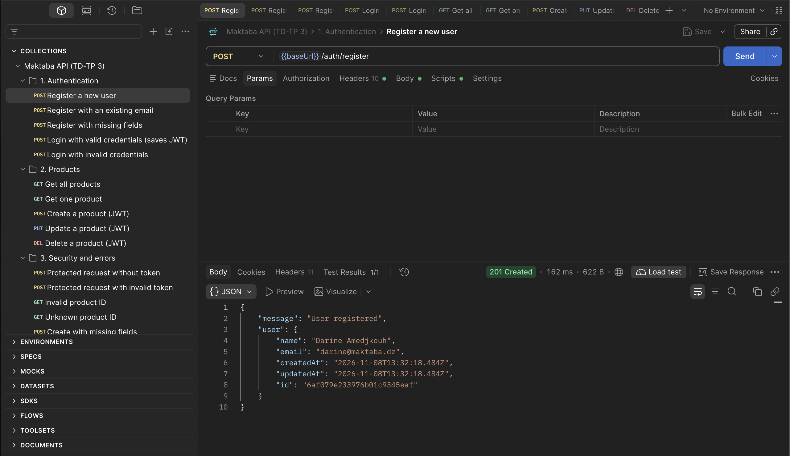 |
| Register with an existing email → **409** | 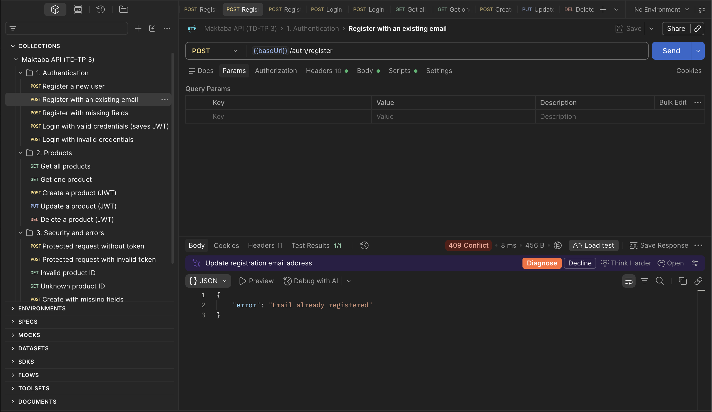 |
| Register with missing fields → **400** | 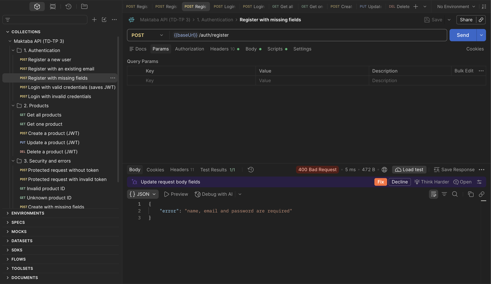 |
| Login with valid credentials → **200** + JWT | 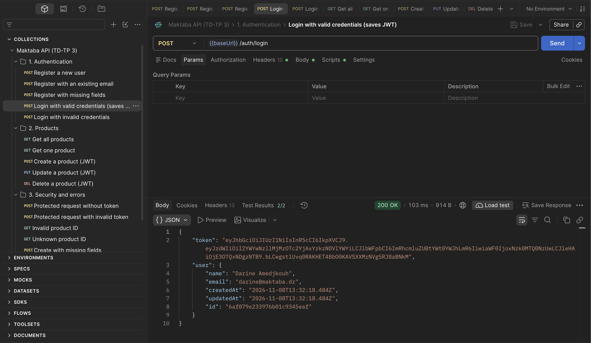 |
| Login with invalid credentials → **401** | 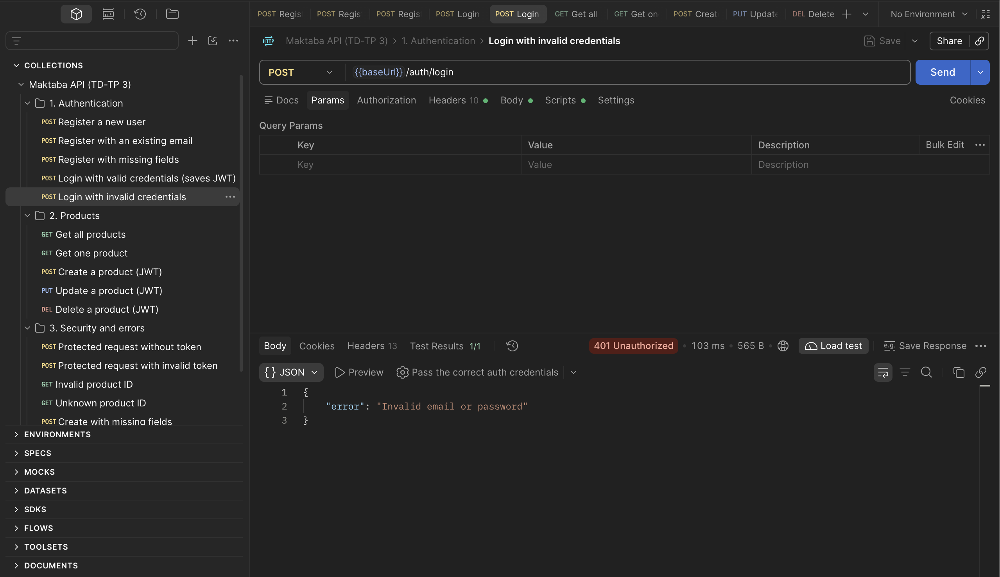 |

#### Product management

| Test | Result |
|---|---|
| Get all products → **200** | 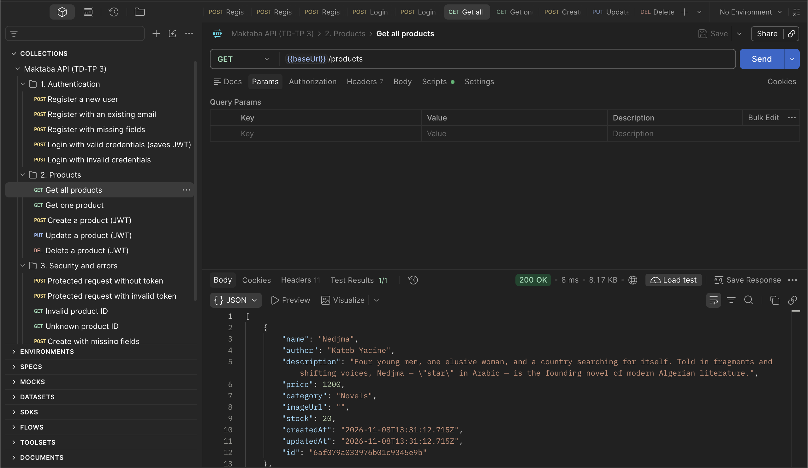 |
| Get one product → **200** | 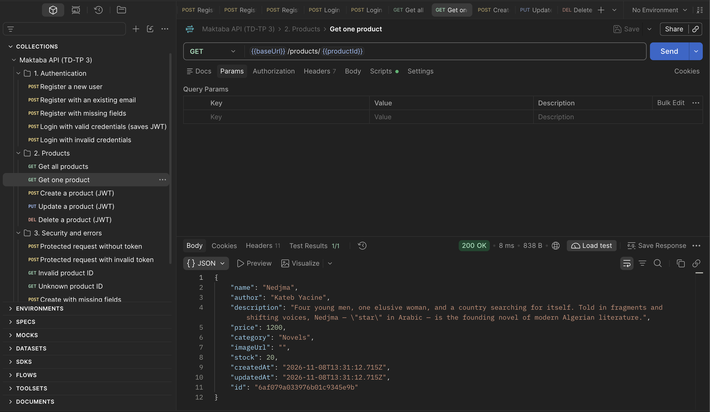 |
| Create a product with a valid token → **201** | 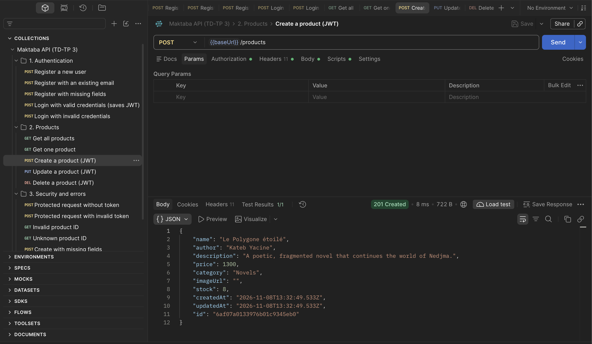 |
| Update a product with a valid token → **200** | 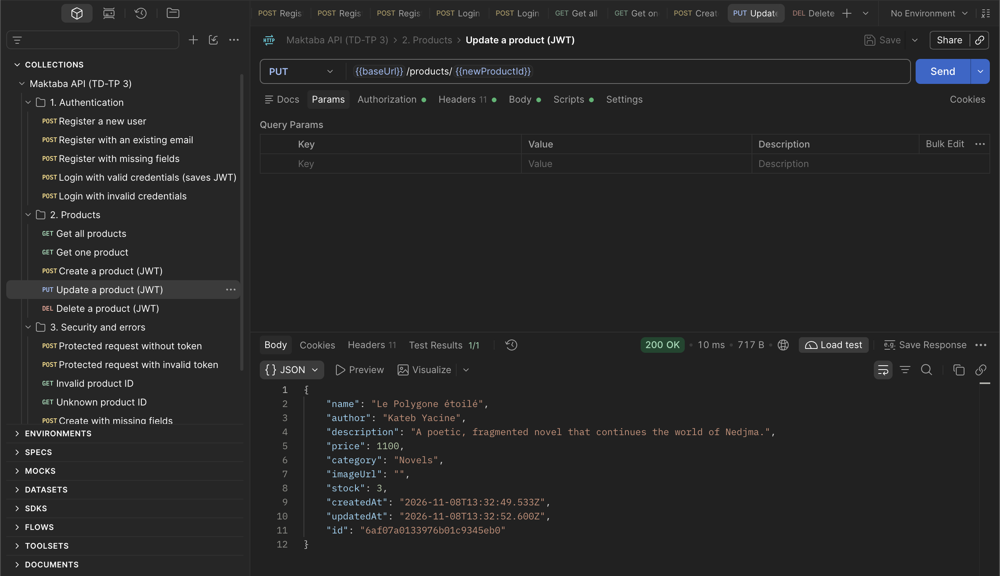 |
| Delete a product with a valid token → **200** | 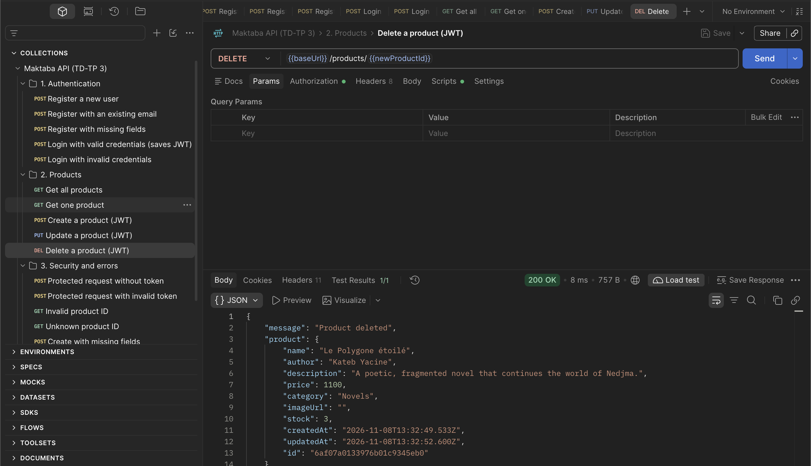 |

#### Security and error handling

| Test | Result |
|---|---|
| Protected request without a token → **401** | 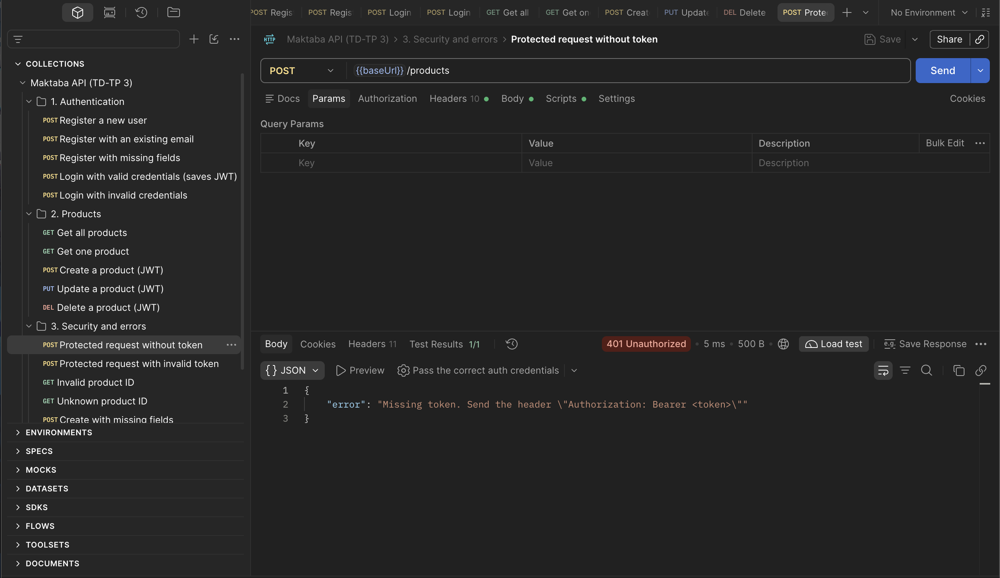 |
| Protected request with an invalid token → **401** | 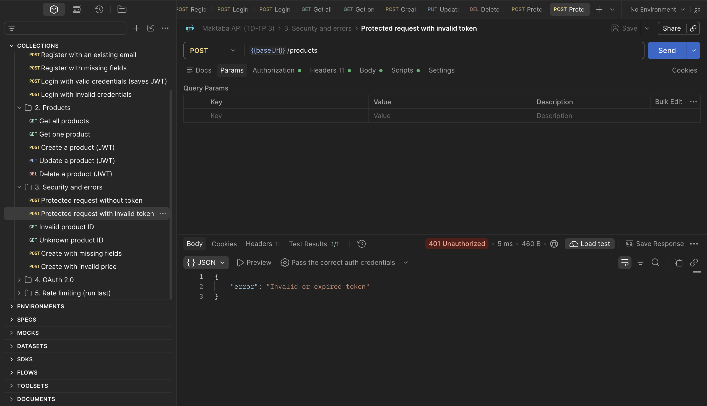 |
| Invalid product ID → **404** | 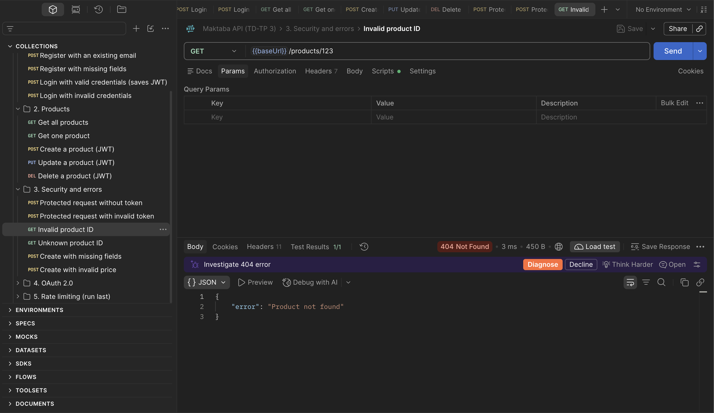 |
| Unknown product ID → **404** | 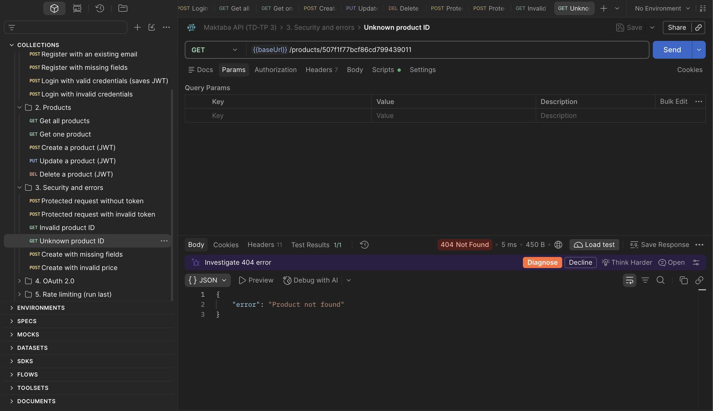 |
| Create with missing fields → **400** | 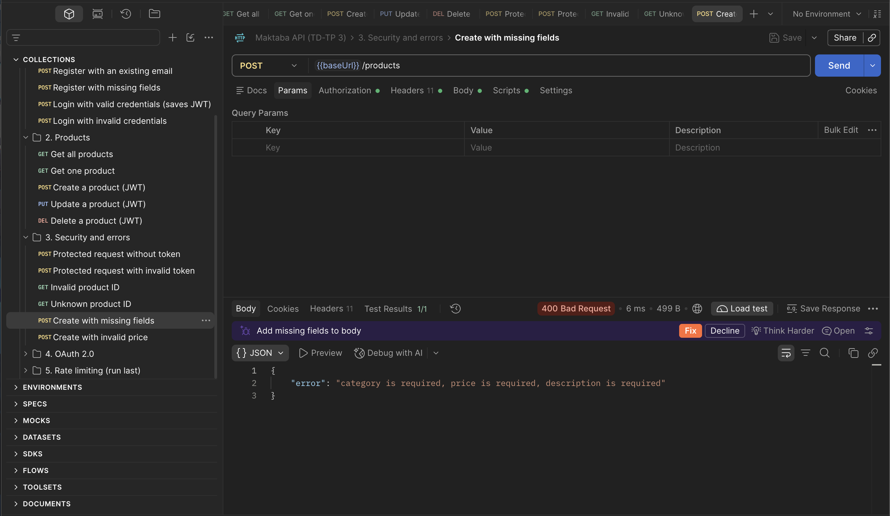 |
| Create with an invalid price → **400** | 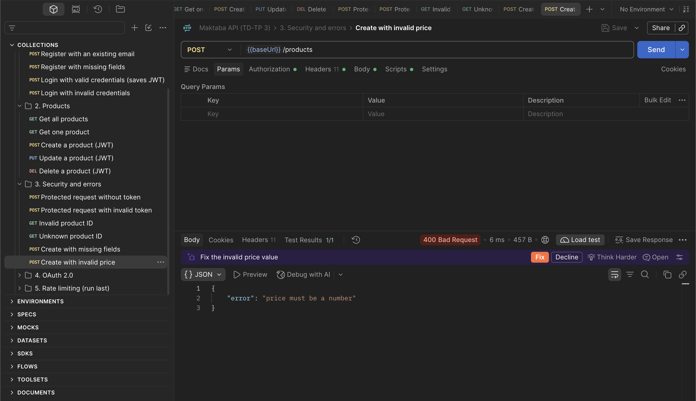 |

#### OAuth 2.0

| Test | Result |
|---|---|
| Token obtained from `/api/oauth/token` (Client Credentials), then used to create a product → **201** | 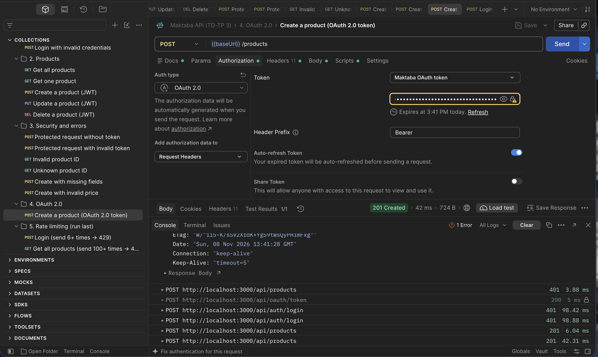 |

#### Rate limiting

| Test | Result |
|---|---|
| Repeated login attempts → **429** after 5 requests | 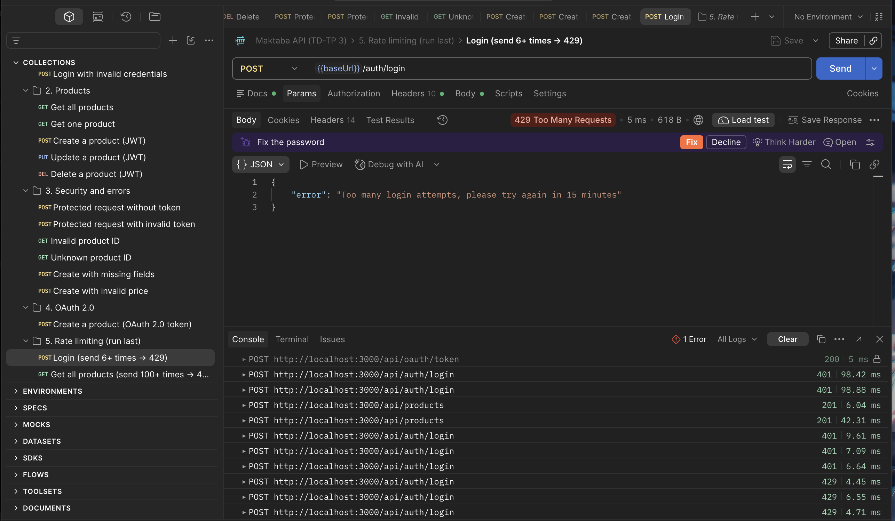 |

<!-- GENERAL_RATE_LIMIT_SCREENSHOT -->

## 12. Connecting the React frontend (next lab)

The API is ready for the TD-TP 2 app: JSON everywhere, CORS allows `http://localhost:5173`,
and `GET /api/products` returns the same books that were in `src/data/products.js`
(`title` is now `name`, and each book has an `id` generated by MongoDB). The shopping cart stays
in Redux, as required.
